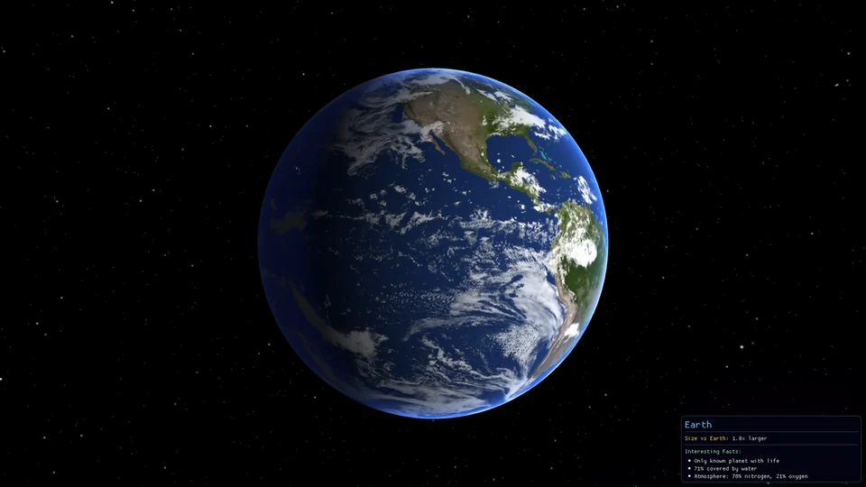

# The Outer World: A Real-Time Solar System in OpenGL

<p align="center">
  
</p>

The Outer World renders the Sun, the eight planets and the Moon in real time with C++ and OpenGL 3.3. The aim is to convey both the beauty and the scale of the solar system: the camera can orbit any body, land on Earth and look up at the sky, or set the Sun beside a planet at their true relative size.

## How it works

1. **Bodies.** Each body is one entry in a table in [`solar_system.cpp`](src/solar_system.cpp) that holds its size, orbit, spin, axial tilt, colors and a few facts. Every frame, the simulation advances the orbit and spin angles, and every body is drawn from the same unit sphere.
2. **Earth.** A dedicated shader blends the day and night maps across the terminator, lights the cities on the night side, darkens the ground under the clouds, and adds the blue rim and the forward glow of the atmosphere.
3. **Saturn's rings.** About 38,600 rocks, each a randomly distorted icosahedron, fill the D, C, B and A rings and the Cassini Division at their observed radii. All of them are drawn in a single instanced call.
4. **Sky.** The background is an 8192 × 4096 star map produced offline by [`starfield_generator.cpp`](tools/starfield_generator.cpp). It places the 8,404 stars of the Yale Bright Star Catalogue down to magnitude 6.5 at their real positions, with a brightness taken from the magnitude and a tint taken from the color index, then adds 10,000 faint stars and three nebulae (Orion, Carina and Cygnus) shaped by fractal noise.
5. **Camera.** The orbiting camera turns with the direction of the Sun, so a focused body keeps the same lighting as it moves along its orbit. In the ground view, the eye stands above Earth's north pole and turns with the planet.

Sizes, distances and speeds are scaled for viewing rather than set to physical proportions. The rocky bodies keep their true size relative to Earth, while the Sun and the giant planets are reduced, distances are compressed, and orbits are circular and share one plane. The size comparison mode is the exception: it shows the Sun and the chosen body at their true proportions.

## Controls

| Input | Action |
| --- | --- |
| Mouse | Turn around the focused body, or look around in the ground view |
| Right click | Focus the next body |
| W / S | Move closer / farther; moving all the way into Earth lands on its surface |
| X | Leave the ground view |
| Up / Down | Double / halve the speed of time, from 1× to 1024× |
| C | Compare the Sun with another body; Left / Right changes the body |
| H | Show or hide satellite orbits around Earth |
| I | Show or hide the information panel |
| Esc | Quit |

The orbits of the planets are drawn while the Sun is in focus.

## Getting Started

### Requirements

- CMake 3.16 or later and a C++20 compiler (GCC 10, Clang 12, MSVC 2019 16.11 or later)
- A graphics card with OpenGL 3.3

GLFW and GLM are used from the system when installed and downloaded by CMake otherwise. Dear ImGui, glad and stb are included in [`third_party/`](third_party).

### Build and run

```bash
git clone https://github.com/YounesToukal/the-outer-world.git
cd the-outer-world
cmake -S . -B build
cmake --build build --config Release
```

The program loads `shaders/` and `assets/` from the working directory, so it is started from the repository root:

```bash
./build/the-outer-world              # Linux and macOS
build\Release\the-outer-world.exe    # Windows
```

It opens in full screen on the main monitor.

### Regenerating the star map

```bash
./build/starfield-generator data/ybsc5.csv assets/textures/starfield.png
```

## Project structure

```
src/
  main.cpp                  entry point
  application.*             main loop, input and display modes
  solar_system.*            table of bodies and their motion
  camera.*                  orbit and ground cameras
  renderer.*                draws the scene and the size comparison
  saturn_rings.*            ring particles and their instanced draw
  orbit_lines.*             orbits drawn as line loops
  overlay.*                 information panels (Dear ImGui)
  mesh.*, shader.*, texture.*, window.*
                            OpenGL and GLFW wrappers
shaders/                    GLSL 3.30 shaders
tools/starfield_generator.cpp
                            offline star map generator
assets/textures/            surface maps and the generated star map
data/ybsc5.csv              Yale Bright Star Catalogue
third_party/                glad, Dear ImGui, stb
```

## License

The code is released under the [MIT License](LICENSE).

The maps of the Sun, the planets and the Moon come from [Solar System Scope](https://www.solarsystemscope.com/textures/) under [CC BY 4.0](https://creativecommons.org/licenses/by/4.0/); some were resized to 2048 × 1024. The star data comes from Hoffleit, D. and Warren, W. H. Jr. (1991), *The Bright Star Catalogue, 5th Revised Edition*, Yale University Observatory, distributed by CDS VizieR as catalogue V/50. The libraries in `third_party/` keep their own licenses.
